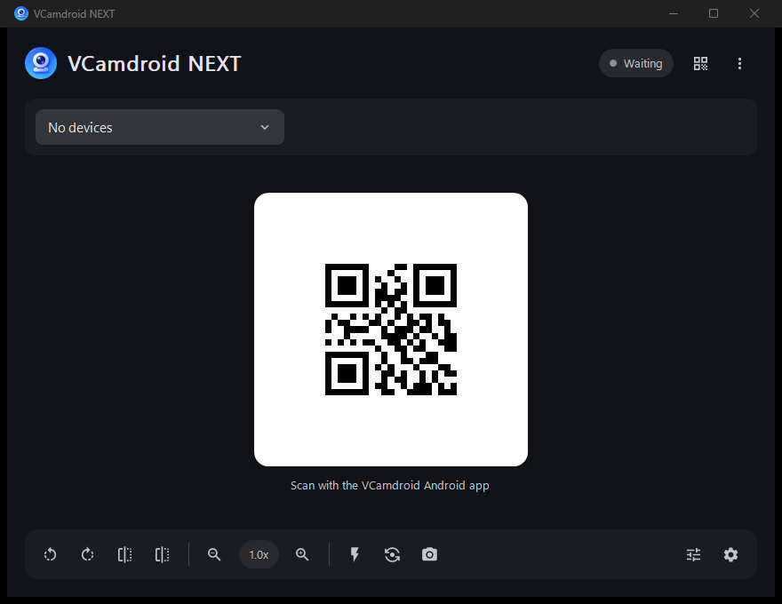
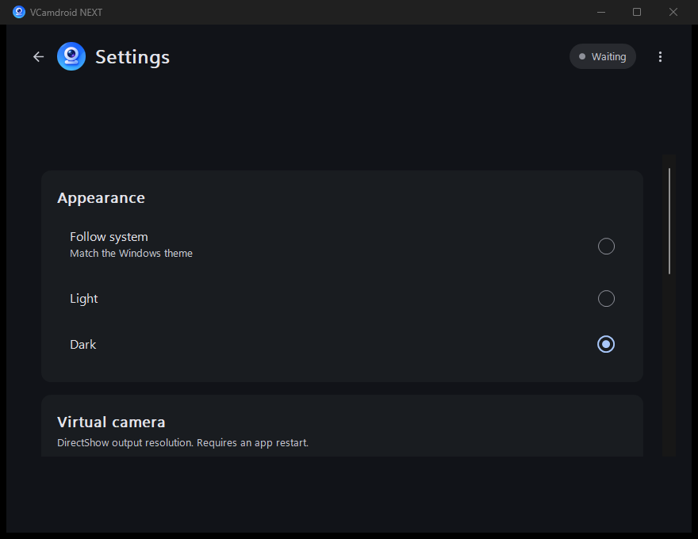
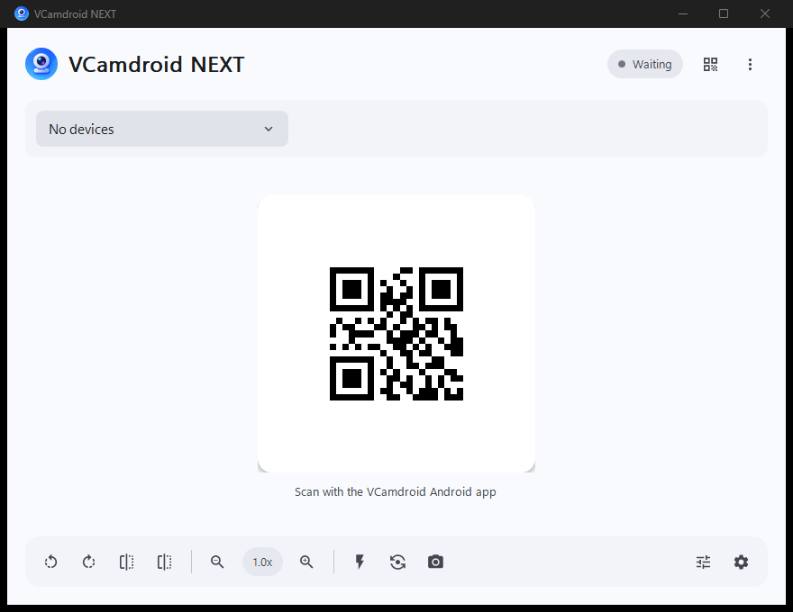
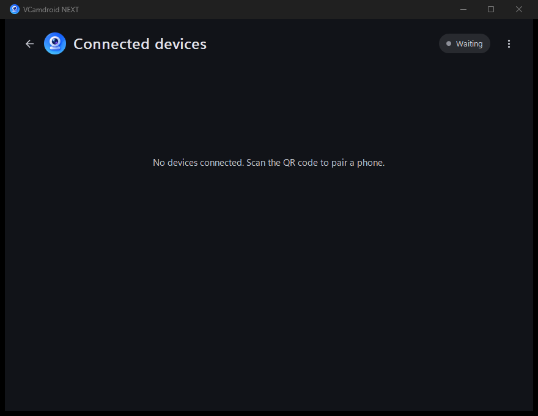

<h1 align="center">
  <sub>
    
  </sub>
  <br>
  VCamdroid NEXT
</h1>

<p align="center">Turn your Android phone into a high-performance Windows webcam.</p>

<p align="center">
  <a href="https://github.com/YossefKhalil/VCamdroid-NEXT/blob/main/LICENSE">
    
  </a>
  <a href="https://github.com/YossefKhalil/VCamdroid-NEXT/releases">
    
  </a>
  <a href="https://github.com/YossefKhalil/VCamdroid-NEXT/releases">
    
  </a>
</p>

<p align="center">
  
  
</p>
<p align="center">
  
  
</p>

---

## Description

**VCamdroid NEXT** is a maintained fork of [VCamdroid](https://github.com/darusc/VCamdroid). It keeps the original idea — your phone's camera presented to Windows as a normal webcam through a virtual DirectShow filter — and rebuilds the experience around it:

- a **material 3 desktop client** with light and dark themes,
- a **working Wi-Fi/QR pairing and streaming pipeline** (the upstream 1.3.x activation packet was mis-parsed by the Android app, so the stream never started),
- a modern, reliable control channel between the phone and the PC.

The stream is hardware-encoded on the phone and decoded on the PC, so it stays smooth and low-latency. The virtual camera is provided by the [Softcam](https://github.com/tshino/softcam) DirectShow filter, which means it works with Zoom, Microsoft Teams, Google Meet, Discord, OBS and anything else that can see a standard webcam.

## What's new in NEXT

VCamdroid NEXT is version **2.0.10-NEXT** and is built on top of the original 1.3.x codebase. Highlights:

### Streaming fixes

- **Wi-Fi pairing now actually streams.** The upstream Android `StreamOptions` parser read four flags as single bytes while the Windows client writes them as big-endian 32-bit integers (and it read a `focusMode` field the PC never sends), so the activation packet was garbage and the RTSP server never started. The parser now matches the wire format exactly.
- **Correct control framing.** The Android packet-length parser read 16-bit lengths little-endian, which inflated the filter count from `7` to `1792` and made the receive buffer grow forever. Fixed.
- **No more crash on a repeated activation.** The encoder codec can only be set before the RTSP server starts; the client now only re-sends activation until video arrives and the phone guards every option apply.
- **The PC no longer stalls its own network thread** while reading a device descriptor, so a slow or half-open connection can never break the live stream.
- **RTSP over TCP** instead of UDP (unreliable on most home networks), with a generous handshake timeout and automatic reconnection.

### Desktop client (Windows)

- **Material 3 interface.** Rebuilt around Material 3: a light/dark blue-ocean palette, cards, tonal controls, rounded surfaces and a proper type scale.
- **Optional theme.** Follow the system theme, or lock the client to Light or Dark.
- **QR code is always ready.** The pairing QR is shown on the main page immediately — no extra "Connect" step.
- **In-app pages instead of modal windows.** Settings and Connected devices are real pages with a back button, which also removes the old crash-on-close dialogs.
- **Automatic device selection.** When a phone connects, the client selects it, switches to the preview and starts the stream on its own.
- **Taskbar controls.** A right-click menu on the tray icon lets you reopen the window or exit.
- **Standard Material icons** throughout (arrow back, rotate, flip, zoom, flash, switch camera, snapshot, settings, and more).
- **Aspect-ratio correct preview** with letterboxing, and a colour fix so the default filter values no longer corrupt saturation.
- **New app icon** — a modern frosted webcam, in circular form, used for the window, taskbar and installer.

### Android app

- **Auto-connect after a valid QR scan** (the old confirmation dialog is gone), with an 8-second connection watchdog.
- **Keep the screen awake** while streaming so the camera never sleeps.
- **Robust TCP framing**, connect timeouts, clean EOF handling and exception-safe sends.
- **Preview restarted at the new resolution** when you change it.
- **Version 2.0.10-NEXT.**

## Key features

- **Universal compatibility:** any Windows app that supports webcams.
- **Flexible connectivity:** USB (ADB, lowest latency) or Wi-Fi with instant QR pairing.
- **Multi-device:** connect several phones and switch between them instantly.
- **Full camera control:** front/back camera, resolution, frame rate, bitrate, torch.
- **Image adjustments:** rotation, mirroring, brightness, contrast, saturation and more.
- **Zero-config pairing:** automatic USB connection through ADB, instant QR pairing over Wi-Fi.
- **Modern desktop UX:** Material 3 client with light/dark themes and a live preview.

## Installation

### Prerequisites

- **PC:** Windows 10 or 11 (x64).
- **Phone:** Android 7.0 (Nougat) or newer.

### Step 1 — Install on Windows

Download **`VCamdroid-NEXT-Setup.exe`** from the [Releases page](https://github.com/YossefKhalil/VCamdroid-NEXT/releases) and run it. The installer:

1. copies the client, its runtime libraries and the included APK,
2. registers `softcam.dll` so the virtual camera appears in other applications,
3. registers the app in the Start Menu and (optionally) on the desktop.

> **Portable option:** the `VCamdroid-NEXT-Portable.zip` release has no installer. Extract it anywhere and run `install.bat` **as Administrator** to register the virtual camera, then launch `VCamdroid NEXT.exe`.

> If Windows Firewall asks, allow the app on **Private** and **Public** networks.

### Step 2 — Install on Android

Install **`VCamdroid-NEXT.apk`** on your phone. You can copy it from the installer's `apk` folder, or use `scripts/install_apk.bat` with USB debugging enabled.

#### Enabling USB debugging

1. **Settings → About phone**.
2. Tap **Build number** seven times until you see "You are now a developer".
3. **Settings → System → Developer options**.
4. Enable **USB debugging**.

## Usage

### Wired (USB / ADB) — recommended

1. Connect the phone with a USB cable.
2. Launch **VCamdroid NEXT** on the PC.
3. Launch **VCamdroid NEXT** on the phone — the connection is automatic.

### Wireless (Wi-Fi)

1. Put the PC and the phone on the same network.
2. Launch the desktop client — the pairing QR code is already on screen.
3. Open the phone app and point the camera at the QR code. It connects on its own.

Once connected, the phone's camera appears in the client preview and in **VCamdroid NEXT** inside any application that lists webcams.

## Troubleshooting

### The app starts but the camera never appears

- Make sure the virtual camera is registered: run `install.bat` as Administrator (portable build), or reinstall with the setup.
- Restart the target application (Zoom/OBS/…) after the client has started.

### Connection failed / host unreachable

1. **Check Windows Firewall:** allow `VCamdroid NEXT.exe` on Private and Public networks.
2. **Check network visibility** (reverse ping):
   ```sh
   adb shell ping -c 4 <PC_IP>
   ```
   If you see packet loss, the router may be isolating clients (AP isolation).

### The app installs but does not replace the old VCamdroid

VCamdroid NEXT uses a new folder (`%LOCALAPPDATA%\Programs\VCamdroid NEXT`) and a new executable name. Uninstall the old **VCamdroid** entry if you no longer need it.

### USB connection is not detected

1. Run `adb devices`. An empty list means a bad cable or missing drivers; "unauthorized" means you must accept the popup on the phone.
2. Kill stray `adb.exe` processes in Task Manager and start the client again.

### "VCRUNTIME140.dll was not found"

The installer ships the Visual C++ runtime. If you use the portable build, install the [latest VC++ Redistributable (x64)](https://aka.ms/vs/17/release/vc_redist.x64.exe).

## Reporting issues

Hardware varies a lot across Android devices, so reports are welcome. Open a [new issue](https://github.com/YossefKhalil/VCamdroid-NEXT/issues) with:

- phone model and Android version,
- connection method (USB or Wi-Fi),
- VCamdroid NEXT version (`2.0.10-NEXT`),
- logs:
  - **Android:** tap the bug icon in the app and share the exported log.
  - **Windows:** attach `vcamdroid.log` from the installation folder.

## Technical architecture

### Networking protocol

VCamdroid NEXT uses **RTSP (Real-Time Streaming Protocol)** for video and a small TCP control channel for commands.

1. **Transport**
   - **Wi-Fi:** the PC connects directly to the RTSP server on the phone over the local network.
   - **USB:** communication uses **ADB port forwarding**; the RTSP stream is tunnelled over TCP through `localhost`.
2. **Libraries**
   - **Phone:** [RootEncoder](https://github.com/pedroSG94/RootEncoder) drives the camera encoder and the RTSP server.
   - **PC:** [FFmpeg](https://ffmpeg.org/) demuxes and decodes the stream; the decoder is chosen from the negotiated codec, so H.264 and H.265/HEVC both work.

<p align="center"></p>

### Video pipeline

1. **Capture, process, encode (Android)**
   - Capture with the **Camera2 API**.
   - Rotate, mirror and colour-correct on the GPU with OpenGL.
   - Encode on the hardware **MediaCodec** (H.264/H.265).
   - Packetise and transmit with **RootEncoder**.
2. **Decode and render (Windows)**
   - Demux and decode with **FFmpeg**.
   - Render into the client preview with correct aspect-ratio scaling.
   - Write frames into the ring buffer managed by [Softcam](https://github.com/tshino/softcam), which exposes them to the registered DirectShow filter.

<p align="center"></p>

## Contributing

Contributions are welcome — fork the repository and open a Pull Request.

### Repository layout

- `android/` — Android Studio project (Kotlin): Camera2 capture, OpenGL processing, RTSP streaming.
- `windows/` — Visual Studio solution (C++): Material 3 desktop client and DirectShow integration.

### Building the Windows client

1. Install **Visual Studio 2022** with the "Desktop development with C++" workload (`v143` toolset).
2. Install `asio`, `wxWidgets 3.3.x` and `FFmpeg` (an MSVC build, e.g. from BtbN) with **vcpkg**:
   ```powershell
   vcpkg install wxwidgets:x64-windows asio:x64-windows
   vcpkg integrate install
   ```
3. Build **softcam** (see the [Softcam repository](https://github.com/tshino/softcam#how-to-build-the-library)).
4. Open `windows/VCamdroid.sln`, select **Release / x64**, set `FFMPEG_ROOT` to the FFmpeg folder and build.
5. Register the filter: run `install.bat` as Administrator in the output directory, or `regsvr32 softcam.dll`.

### Building the Android app

1. Install the latest **Android Studio**.
2. Open the `android/` folder as a project.
3. Let Gradle sync, then build the `app` module. Use a physical device — emulators lack the required encoder hardware.

## Credits

VCamdroid NEXT is a fork of [darusc/VCamdroid](https://github.com/darusc/VCamdroid) by Darius Cirneala. Huge thanks to the original author, to [pedroSG94](https://github.com/pedroSG94) for RootEncoder, and to [tshino](https://github.com/tshino) for Softcam.

## License

Released under the same license as the original project. See [LICENSE](LICENSE).
